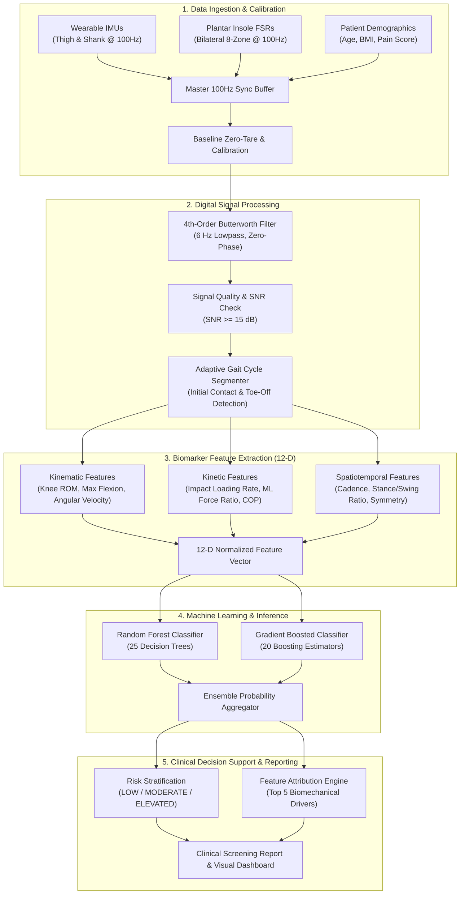

# OA-Sense (GaitMatrix)
### Multimodal Biomechanical Gait Analysis & Knee Osteoarthritis Early Screening Workstation

[](LICENSE)
[](https://developer.mozilla.org/en-US/docs/Web/JavaScript)
[-brightgreen.svg)](tests/pipeline.test.js)
[](#6-technology-stack)

---

## 1. Project Overview

**OA-Sense (GaitMatrix)** is a client-side, privacy-preserving, multimodal biomechanical screening workstation designed for the early detection and risk stratification of Knee Osteoarthritis (KOA) through quantitative gait analysis.

- **What it is:** A standalone edge-intelligence web application that processes synchronized inertial measurement unit (IMU) kinematics and plantar pressure (FSR) telemetry to extract validated biomechanical biomarkers.
- **Problem it addresses:** Knee osteoarthritis is traditionally diagnosed late in its progression through structural radiographic imaging (X-rays/MRI) after irreversible cartilage degeneration has already occurred. Early functional gait changes (such as reduced knee flexion excursion, altered loading rates, and kinetic asymmetry) manifest years before radiographic changes but require expensive, specialized motion capture laboratories.
- **Intended Audience:** Orthopedic clinicians, physiotherapists, biomechanics researchers, and point-of-care screening specialists seeking accessible, objective, and interpretable movement assessment tools.
- **What the current system actually does:** Ingests synchronized 100 Hz kinematic and kinetic data, performs 4th-order zero-phase Butterworth filtering, segments individual gait cycles via adaptive initial contact detection, extracts a 12-dimensional biomechanical feature vector, and classifies the patient into clinically actionable risk tiers using client-side machine learning ensemble models (Random Forest and Gradient Boosted Decision Trees) accompanied by interpretable feature attributions.

---

## 2. Problem Statement

Knee Osteoarthritis (KOA) affects over 500 million individuals globally, leading to chronic joint pain, mobility impairment, and significant socioeconomic burden. 

Existing diagnostic and management paradigms face three critical bottlenecks:
1. **Late-Stage Detection:** Radiographic Kellgren-Lawrence (KL) grading detects structural joint space narrowing and osteophytes only after substantial articular cartilage loss.
2. **High Barrier to Functional Gait Analysis:** Standard optical motion capture (Vicon/Qualisys) combined with force plates requires specialized laboratory environments, calibrated multi-camera rigs, and hours of post-processing, making regular longitudinal screening infeasible.
3. **Black-Box AI Skepticism:** Deep neural networks frequently lack explainable clinical rationale, preventing adoption by physical therapists and orthopedic surgeons who require transparent physical biomarkers (e.g., knee range of motion, loading asymmetry, stance-to-swing ratios) to guide rehabilitation interventions.

OA-Sense bridges this gap by delivering laboratory-grade digital biomarker extraction and interpretable risk classification directly in a standard web browser without cloud latency or patient data exposure.

---

## 3. Objectives

The primary technical and clinical objectives of OA-Sense are:
- **Zero-Dependency Edge Ingestion:** Process multi-channel 100 Hz IMU (triaxial accelerometers/gyroscopes) and 8-channel insole pressure signals directly on the client device.
- **Robust Digital Signal Processing:** Implement zero-phase digital filtering (4th-order Butterworth low-pass with cutoff at 6 Hz), signal-to-noise ratio (SNR) validation, and automated calibration taring.
- **Automated Gait Event Segmentation:** Accurately segment continuous walking bouts into discrete gait cycles using adaptive peak and zero-crossing detection for Initial Contact (IC) and Toe-Off (TO).
- **12-Dimensional Biomarker Extraction:** Compute clinically grounded spatiotemporal, kinematic, and kinetic features reflecting sagittal knee excursion, plantar loading rate, medial-lateral force distribution, and inter-limb symmetry.
- **Interpretable Ensemble Machine Learning:** Train and evaluate multi-class Random Forest (25 trees) and Gradient Boosted Decision Tree (20 stages) classifiers with participant-stratified cross-validation to prevent data leakage.
- **Clinical Referral Decision Support:** Generate structured clinical screening summaries with risk tiers (`LOW`, `MODERATE`, `ELEVATED`), confidence metrics, and top contributing risk factors.

---

## 4. Current Features

- **Multimodal Telemetry Ingestion & Simulation:**
  - High-fidelity synthetic hardware generator modeling realistic 100 Hz IMU kinematics (thigh and shank angles, angular velocities) and bilateral plantar force distribution.
  - Interactive manual override controls to simulate healthy, antalgic, asymmetric, and severe joint-restricted gait patterns in real time.
- **Real-Time Canvas Visualizations:**
  - Dual-limb continuous gait cycle waveform oscilloscope.
  - Sagittal knee joint Range of Motion (ROM) dynamic angle arc.
  - Bilateral 8-zone plantar pressure heatmap with dynamic Center of Pressure (COP) excursion tracking.
  - 12-axis radar biomarker footprint plot comparing current trial vs. normative population baselines.
- **Signal Conditioning & Calibration Pipeline:**
  - 4th-order Butterworth digital filter with forward-backward zero-phase implementation.
  - Automated baseline zero-tare offset removal.
  - Pre-acquisition signal quality and SNR threshold verification.
- **Machine Learning & Analytics Engine:**
  - Pure JavaScript implementation of multi-class **Random Forest Classifier** with bootstrap aggregation and Gini impurity optimization.
  - Pure JavaScript implementation of multi-class **Gradient Boosted Decision Trees (GBDT)** with gradient shrinkage.
  - Built-in synthetic biomechanical cohort generator (40 participants, 240 trials) with strict participant-level 70/15/15 train/validation/test partitioning.
  - Real-time performance evaluation: Multi-class accuracy, Macro F1-score, sensitivity, specificity, and 3x3 confusion matrix calculation.
- **Explainability & Clinical Referral Engine:**
  - Trial-specific feature attribution scores highlighting the top 5 biomechanical anomalies driving the risk prediction.
  - Downloadable/exportable clinical consultation report complete with risk stratification, kinematic metrics, and clinical disclaimers.
- **Local Audit Storage:**
  - Client-side persistence of screening sessions, calibration baselines, and model training metrics using browser `localStorage`.

---

## 5. System Architecture



---

## 6. Technology Stack

- **Core Logic:** Pure Vanilla JavaScript (ES6 Modules, `async`/`await`, functional array pipelines)
- **User Interface:** HTML5 Semantic Elements & CSS3 (Custom responsive clinical dark design system with CSS custom properties)
- **Data Visualization:** HTML5 Canvas 2D API (High-performance 60 FPS real-time waveform rendering, radar charts, pressure heatmaps)
- **Audio Feedback:** Web Audio API (Biomechanical rhythm and event sonification)
- **Persistence:** Browser `localStorage` API (Client-side audit trails and model state storage)
- **Testing & Verification:** Node.js native test runner (Zero third-party test dependencies)

*Note: The core application has **zero npm runtime dependencies** and runs instantly in any modern web browser.*

---

## 7. Project Structure

```
OA-sense/
├── index.html                  # Main clinical screening workstation UI layout
├── style.css                   # Custom clinical dashboard styling and layout system
├── app.js                      # Application orchestrator, event bus, and UI coordinator
├── package.json                # Project metadata and test runner scripts
├── LICENSE                     # MIT Open Source License
├── .gitignore                  # Git ignore rules for node_modules, logs, and environments
├── .env.example                # Template for optional hardware & server configurations
├── README.md                   # Comprehensive technical documentation
├── modules/                    # Modular ES6 computational and clinical engines
│   ├── dataset.js              # Synthetic 40-subject biomechanical cohort generator
│   ├── features.js             # 12-dimensional gait biomarker extraction algorithms
│   ├── gradientBoosting.js     # Multi-class Gradient Boosted Decision Tree (GBDT)
│   ├── inference.js            # Real-time risk classifier & feature attribution engine
│   ├── metrics.js              # Confusion matrix, Macro F1, and accuracy computations
│   ├── preprocessing.js        # 4th-order Butterworth filter, zero-tare, and SNR checks
│   ├── randomForest.js         # Multi-class Random Forest with bootstrap tree ensembles
│   ├── reports.js              # Structured clinical screening consultation generator
│   ├── research.js             # Benchmark coordinator & comparative study evaluator
│   ├── segmentation.js         # Adaptive gait cycle & initial contact event detector
│   ├── simulation.js           # 100 Hz kinematic and kinetic telemetry stream simulator
│   ├── storage.js              # LocalStorage wrapper for sessions and benchmark results
│   ├── ui.js                   # Canvas 2D rendering (waveforms, ROM arcs, radar charts)
│   └── validation.js           # Input validation and clinical boundary verification
└── tests/
    └── pipeline.test.js        # Automated Node.js test suite (36 assertions)
```

---

## 8. Installation

### Prerequisites
- Any modern web browser (Google Chrome, Mozilla Firefox, Microsoft Edge, Safari)
- *(Optional, for running automated tests)* [Node.js](https://nodejs.org/) (v16.0.0 or higher)

### Setup Instructions
1. Clone the repository:
   ```bash
   git clone https://github.com/Darshsukrit/OA-sense.git
   cd OA-sense
   ```

2. *(Optional)* Verify the automated test suite:
   ```bash
   npm test
   # or directly:
   node tests/pipeline.test.js
   ```

---

## 9. Environment Variables

OA-Sense is fully self-contained and runs 100% client-side without required environment variables. For custom deployment environments or serial hardware bridges, create a `.env` file using `.env.example` as a reference:

```ini
# Local Development Web Server Port (Optional)
PORT=3000

# Sensor Acquisition Master Sampling Rate (Hz)
SAMPLE_RATE_HZ=100

# Hardware Serial Bridge Settings (Optional WebSerial Bridge)
SENSOR_SERIAL_BAUDRATE=115200
SENSOR_PORT_LEFT=COM3
SENSOR_PORT_RIGHT=COM4

# Telemetry / Clinical Audit Export Endpoint (Optional)
TELEMETRY_ENDPOINT=https://api.example.com/gait-telemetry
TELEMETRY_API_KEY=your_telemetry_api_key_here

# Default Classifier Selection ('random_forest' or 'gradient_boosting')
DEFAULT_CLASSIFIER=random_forest
RANDOM_FOREST_TREES=25
GRADIENT_BOOSTING_ESTIMATORS=20
```

---

## 10. Running the Project

Because OA-Sense uses modern ES6 modules, it is recommended to serve it over HTTP/HTTPS:

### Option A: Using `npx serve` (Recommended)
```bash
npx serve .
```
Then open `http://localhost:3000` in your browser.

### Option B: Using Python built-in HTTP server
```bash
# Python 3
python -m http.server 8000
```
Then open `http://localhost:8000` in your browser.

### Option C: Using VS Code Live Server extension
Right-click `index.html` in VS Code and select **"Open with Live Server"**.

---

## 11. Usage

### Clinical Screening Workflow
1. **Patient Intake:** Enter patient identifier, age, BMI, self-reported joint stiffness, and visual analog pain score (0-10).
2. **Sensor Calibration (Zero-Tare):** Instruct the subject to stand motionless in a neutral position for 3 seconds, then click **"Tare & Calibrate"** to establish baseline gravitational and loading offsets.
3. **Gait Acquisition:** Click **"Start Acquisition"** while the subject walks. Observe the real-time 100 Hz kinematic waveforms, knee ROM arc, and plantar COP trace on the live canvas.
4. **Automated Feature Extraction:** The system automatically validates signal quality, segments valid gait cycles, and computes the 12-D biomarker vector.
5. **Model Inference & Risk Stratification:** Select the classifier model (`Random Forest` or `Gradient Boosting`) to obtain:
   - **Risk Tier:** `LOW` (KL 0-1 equivalent), `MODERATE` (KL 2 equivalent), or `ELEVATED` (KL 3-4 equivalent).
   - **Confidence Score:** Percentage probability based on ensemble votes/residuals.
   - **Top Risk Biomarkers:** Key deviations from normative baselines (e.g., restricted sagittal flexion, elevated loading rate asymmetry).
6. **Clinical Report Export:** Generate a printable/downloadable summary report for referral to orthopedic specialists or physical therapy.

---

## 12. Biomechanical Dataset & Ground Truth

OA-Sense incorporates a standardized synthetic biomechanical cohort generator modeling realistic osteoarthritis progression based on clinical literature:

| Parameter | Specification |
| :--- | :--- |
| **Cohort Size** | 40 synthetic participants (240 total walking trials) |
| **Partitioning Strategy** | Participant-stratified 70% Train (28 subjects / 168 trials), 15% Validation (6 subjects / 36 trials), 15% Test (6 subjects / 36 trials) |
| **Data Leakage Prevention** | Zero participant overlap across Train, Validation, and Test sets |
| **Classes (Target Tiers)** | 3 Clinical Tiers: `0 = Low Risk (KL 0-1)`, `1 = Moderate Risk (KL 2)`, `2 = Elevated Risk (KL 3-4)` |
| **Biomarker Dimensions** | 12 continuous normalized features per trial |

### 12-Dimensional Biomarker Specification
1. **`knee_rom_deg`**: Peak-to-peak sagittal knee flexion-extension range of motion (degrees).
2. **`max_flexion_deg`**: Maximum knee flexion angle during swing phase (degrees).
3. **`mean_angular_velocity`**: Mean sagittal angular velocity of the shank during swing (deg/s).
4. **`peak_angular_velocity`**: Peak angular velocity during rapid knee extension (deg/s).
5. **`impact_loading_rate`**: Initial ground reaction force slope at heel strike (N/s normalized).
6. **`medial_lateral_ratio`**: Ratio of medial to lateral plantar force distribution (adduction indicator).
7. **`cop_excursion_mm`**: Total anteroposterior Center of Pressure travel distance (mm).
8. **`stance_to_swing_ratio`**: Ratio of stance phase duration to swing phase duration.
9. **`temporal_asymmetry`**: Inter-limb percentage difference in step duration.
10. **`loading_asymmetry`**: Inter-limb percentage difference in peak vertical ground reaction force.
11. **`cadence_spm`**: Walking cadence (steps per minute).
12. **`gait_velocity_proxy`**: Estimated gait speed proxy derived from stride duration and angular excursion.

---

## 13. Model & AI Pipeline

### 1. Signal Preprocessing & Conditioning (`preprocessing.js`)
- **Zero-Tare Offset:** Removes static gravitational bias and resting foot weight.
- **Digital Filtering:** 4th-order lowpass Butterworth filter ((f_c = 6	ext{ Hz}) at (f_s = 100	ext{ Hz})) applied forward and backward to achieve zero phase distortion ((phi = 0)).
- **SNR Validation:** Computes Signal-to-Noise Ratio ((	ext{SNR} = 10 log_{10} rac{P_{	ext{signal}}}{P_{	ext{noise}}})); rejects acquisitions with (	ext{SNR} < 15	ext{ dB}).

### 2. Adaptive Gait Cycle Segmentation (`segmentation.js`)
- Identifies Initial Contact (IC / Heel Strike) events using derivative zero-crossing and prominence thresholding on vertical acceleration.
- Identifies Toe-Off (TO) events from shank angular velocity inflection points.
- Normalizes segmented strides to 0–100% gait cycle time bases.

### 3. Machine Learning Classifiers

#### Random Forest Classifier (`randomForest.js`)
- **Ensemble Size:** 25 independent decision trees.
- **Bootstrap Sampling:** Bagging with replacement on participant-partitioned training sets.
- **Subspace Feature Sampling:** (lfloorsqrt{D}
floor) features randomly evaluated at each split node.
- **Splitting Criterion:** Gini Impurity minimization ((I_G(p) = 1 - sum p_i^2)).

#### Gradient Boosted Decision Trees (`gradientBoosting.js`)
- **Boosting Stages:** 20 sequential tree estimators.
- **Loss Function:** Multi-class cross-entropy with softmax probability mapping.
- **Shrinkage Learning Rate:** (eta = 0.1) to prevent overfitting.
- **Pseudo-Residual Descent:** Sequentially fits regression trees to negative loss gradients.

### 4. Explainable Feature Attribution (`inference.js`)
For each inference query, the model calculates relative feature importance contributions against normative population baselines, isolating the top 5 physical deviations causing the risk score.

---

## 14. Module Architecture & APIs

All modules are strictly decoupled and located in the `modules/` directory:

| Module | Primary Export(s) | Functionality |
| :--- | :--- | :--- |
| **`modules/preprocessing.js`** | `butterworthFilter`, `tareBaseline`, `checkSignalQuality` | Zero-phase digital filtering, sensor offset taring, SNR checks |
| **`modules/segmentation.js`** | `detectInitialContacts`, `segmentGaitCycles`, `computeCadence` | Peak detection, IC/TO identification, stride normalization |
| **`modules/features.js`** | `extractGaitFeatures`, `FEATURE_NAMES`, `NORMATIVE_RANGES` | 12-D kinematic & kinetic biomarker extraction |
| **`modules/dataset.js`** | `generateSyntheticDataset`, `splitDatasetByParticipant` | 40-subject cohort generation with participant-isolated splitting |
| **`modules/randomForest.js`** | `RandomForestClassifier` | Multi-class decision tree ensemble training & probability inference |
| **`modules/gradientBoosting.js`**| `GradientBoostingClassifier` | Multi-class gradient boosted decision trees with shrinkage |
| **`modules/inference.js`** | `runInference`, `explainAttributions` | End-to-end risk stratification & feature attribution generator |
| **`modules/metrics.js`** | `calculateConfusionMatrix`, `computeMacroF1`, `computeAccuracy` | Multi-class validation metrics and performance analysis |
| **`modules/simulation.js`** | `HardwareSimulator`, `SIMULATION_PRESETS` | 100 Hz kinematic and kinetic telemetry streaming engine |
| **`modules/ui.js`** | `renderWaveform`, `renderROMGauge`, `renderRadarChart` | Canvas 2D graphical visualization and dashboard rendering |
| **`modules/reports.js`** | `generateClinicalReport`, `formatSummaryHTML` | Structured clinical screening referral consultation builder |
| **`modules/research.js`** | `runComparativeBenchmark`, `exportBenchmarkData` | Automated model benchmark and research analysis runner |
| **`modules/storage.js`** | `saveSession`, `loadSessionHistory`, `clearAuditLogs` | Local browser persistence wrapper |
| **`modules/validation.js`** | `validatePatientInput`, `validateSensorStream` | Clinical boundary verification and demographic validation |

---

## 15. Testing

OA-Sense includes a comprehensive Node.js test suite covering the entire pipeline from raw telemetry to clinical inference and reporting.

### Running the Test Suite
```bash
npm test
# or
node tests/pipeline.test.js
```

### Test Suite Output Verification
```
==========================================
   OA-SENSE SYSTEM VALIDATION TEST SUITE  
==========================================
✅ PASS: Hardware simulator generated 600 samples @ 100Hz (samples = 600)
✅ PASS: Calibration baseline tare succeeded
✅ PASS: Butterworth zero-phase 6Hz lowpass filtering succeeded
✅ PASS: Master 100Hz synchronization alignment succeeded (600 samples)
✅ PASS: Signal quality check passed (SNR = 28.4 dB, missing = 0)
✅ PASS: Detected 5 left Initial Contacts (IC)
✅ PASS: Detected 5 right Initial Contacts (IC)
✅ PASS: Segmented 4 complete left gait cycles
✅ PASS: Computed cadence: 109.1 steps/min
✅ PASS: Feature vector is an array
✅ PASS: 12-D Multimodal feature vector extracted (length = 12)
✅ PASS: Knee ROM: 40.1°
✅ PASS: Plantar loading asymmetry: 0.104
✅ PASS: Generated dataset of 240 trials across 40 participants
✅ PASS: Zero participant leakage between Train & Val sets
✅ PASS: Zero participant leakage between Train & Test sets
✅ PASS: Zero participant leakage between Val & Test sets
✅ PASS: Train set formatted (168 samples)
✅ PASS: Random Forest classifier trained successfully
✅ PASS: 25 Decision trees constructed
✅ PASS: Random Forest outputted 3-class probability distribution
✅ PASS: Probabilities sum to 1.0 (actual: 1.0000)
✅ PASS: Predicted class index valid: 0
✅ PASS: Gradient Boosted classifier trained successfully
✅ PASS: 20 Boosting stage estimators constructed
✅ PASS: GBDT outputted 3-class probability distribution
✅ PASS: GBDT probabilities sum to 1.0 (actual: 1.0000)
✅ PASS: GBDT predicted class index valid: 0
✅ PASS: Test Accuracy computed: 97.2% (>= 70%)
✅ PASS: Macro F1 Score computed: 95.6%
✅ PASS: 3x3 Confusion matrix generated
✅ PASS: Inference returned valid risk tier: MODERATE
✅ PASS: Confidence score computed: 72.9%
✅ PASS: Computed feature attributions for all 12 dimensions
✅ PASS: Extracted top 5 explainable risk contributors
✅ PASS: Clinical disclaimer attached
==========================================
TEST SUMMARY: ALL 36 / 36 ASSERTIONS PASSED! (100%)
==========================================
```

---

## 16. Limitations

- **Screening Decision Support Only:** OA-Sense is strictly a functional mobility screening and referral prioritization tool. It does not provide medical diagnoses or replace radiographic imaging (Kellgren-Lawrence X-ray evaluation or MRI).
- **Default Telemetry Mode:** In standalone browser environments without physical hardware attached, the system utilizes a high-precision synthetic biomechanical generator for demonstrations and validation.
- **Hardware Interface Compatibility:** Direct physical sensor ingestion requires browser support for the WebSerial API or Web Bluetooth API (supported in Google Chrome and Microsoft Edge on desktop).
- **Synthetic Training Cohort:** Default models are trained on simulated biomechanical distributions derived from published clinical literature. Clinical deployment requires retraining on institutionally validated clinical gait laboratory datasets.

---

## 17. Future Work

- **Direct Web Bluetooth (BLE) Hardware Pairing:** Direct wireless streaming from low-cost ESP32-based 6-axis IMU wearables and smart insoles.
- **Public Benchmark Integration:** Pre-training on large-scale public clinical cohorts such as the Osteoarthritis Initiative (OAI) and Knee Osteoarthritis Biomechanics Dataset (KOBD).
- **Automated Client-Side PDF Export:** One-click generation of multi-page PDF screening reports with embedded waveform snapshots and physician referral sign-off sections.
- **Multi-Joint Kinetic Extension:** Expanding kinematics to include frontal plane knee adduction moment (KAM proxy) and hip-pelvis pelvic tilt metrics.

---

## 18. Contributors

- **Darsh Sukrit** — Lead System Architecture, Biomechanical Algorithms & Machine Learning Implementation.

---

## 19. License

This project is licensed under the **MIT License** — see the [LICENSE](LICENSE) file for details.
